<div align="center">


# Smart School Management System

**A role-based school management platform for administrators, teachers, students and parents.**<br />
Attendance, assignments, results, fees, timetables and the school calendar, in one place.

<br />

<a href="https://smart-school-management-system-frontend-sieb.onrender.com"></a>

<br />


<a href="#-license"></a>

<br /><br />

**[Live app](https://smart-school-management-system-frontend-sieb.onrender.com)** ·
**[Backend repository](https://github.com/AashiQMahato/Smart-School-management-system-Backend)** ·
**[Screenshots](#-screenshots)** ·
**[Getting started](#-getting-started)** ·
**[Architecture](#-architecture)**

</div>

<br />

## 📑 Contents

- [Overview](#-overview)
- [Screenshots](#-screenshots)
- [Key features](#-key-features)
- [Role-based access](#-role-based-access)
- [UI and UX highlights](#-ui-and-ux-highlights)
- [Technology stack](#-technology-stack)
- [Architecture](#-architecture)
- [Getting started](#-getting-started)
- [Environment variables](#-environment-variables)
- [Project structure](#-project-structure)
- [Deployment](#-deployment)
- [Future improvements](#-future-improvements)
- [Contributing](#-contributing)
- [License](#-license)
- [Developer](#-developer)

<br />

## 🎯 Overview

Smart School is the React frontend of a MERN-stack school management system. It has a public landing page, a sign-in page, and four role-based dashboards. Every account is created by a school administrator; there is no public sign-up.

After signing in, each person lands on the dashboard for their role and sees only what that role allows. The same student record serves everyone: administrators manage it, teachers mark attendance and grades against it, students follow their own progress, and parents see their linked children.

<table>
  <tr>
    <td align="center" width="25%"><br /><b>Administrator</b><br /><sub>Runs the school: people, classes, timetables, fees, results</sub></td>
    <td align="center" width="25%"><br /><b>Teacher</b><br /><sub>Attendance, assignments, grading and marks entry</sub></td>
    <td align="center" width="25%"><br /><b>Student</b><br /><sub>Timetable, assignments, attendance, results, fees</sub></td>
    <td align="center" width="25%"><br /><b>Parent</b><br /><sub>Each child's attendance, results, fees and timetable</sub></td>
  </tr>
</table>

<br />

## 📸 Screenshots

> Captured from the application itself (built from this repository) running against demo data, so no real school's records are shown.

<p align="center">
  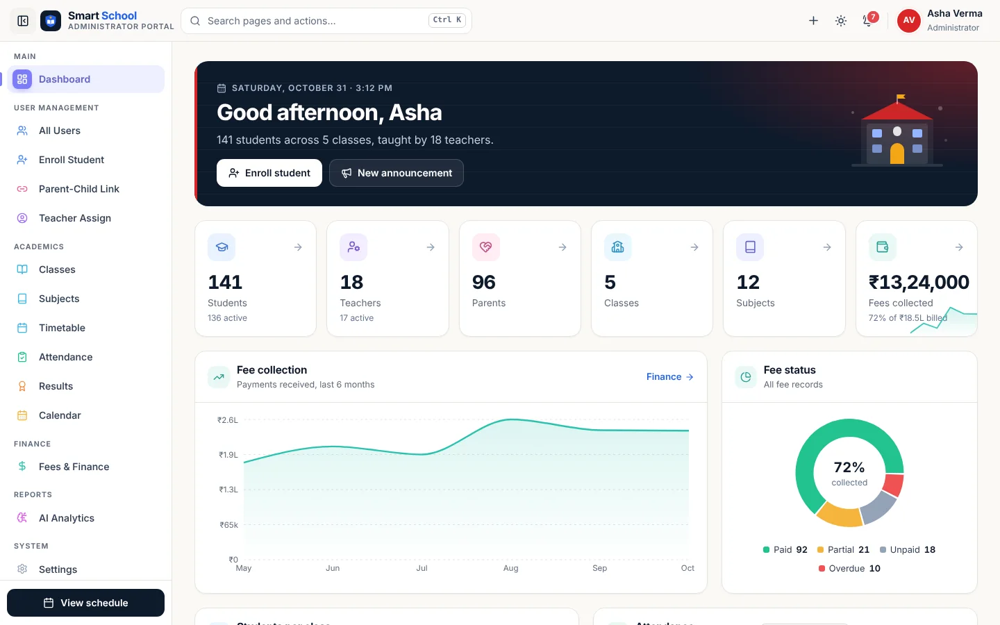
  <br />
  <sub><b>Admin dashboard</b>: headline counts, fee collection over six months, fee status, students per class and attendance by class</sub>
</p>

<table>
  <tr>
    <td width="50%" align="center">
      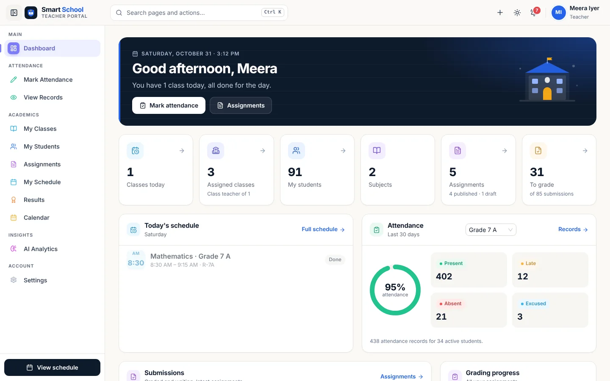<br />
      <sub><b>Teacher</b>: today's classes, attendance for a chosen class, grading progress</sub>
    </td>
    <td width="50%" align="center">
      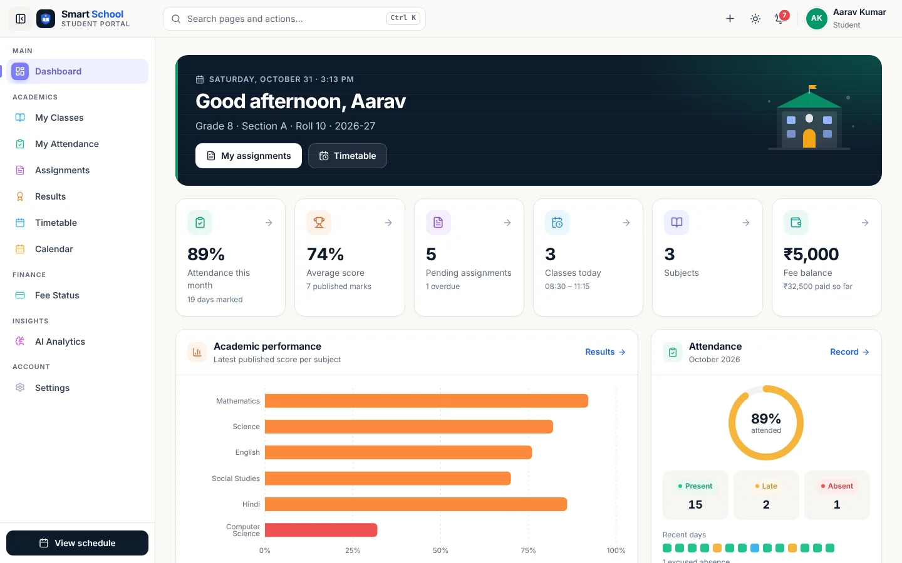<br />
      <sub><b>Student</b>: attendance, performance by subject, deadlines and timetable</sub>
    </td>
  </tr>
  <tr>
    <td width="50%" align="center">
      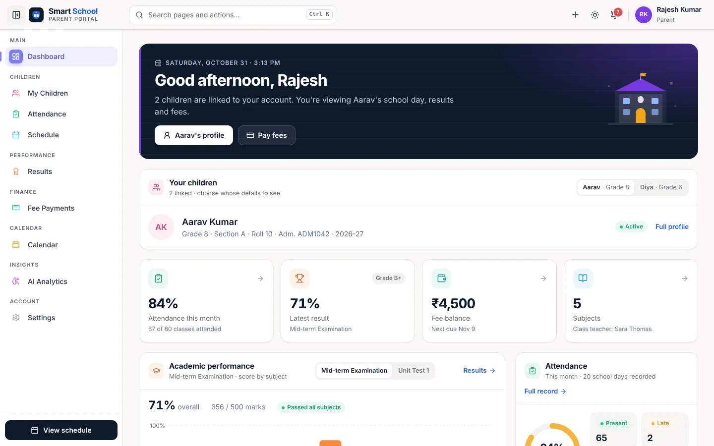<br />
      <sub><b>Parent</b>: child selector, results, attendance and fees for each child</sub>
    </td>
    <td width="50%" align="center">
      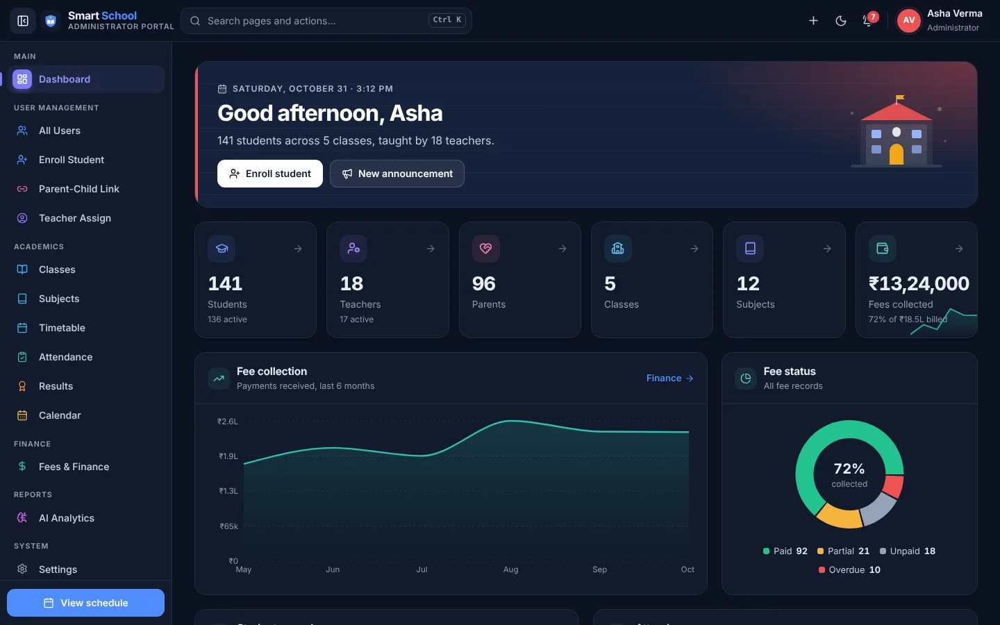<br />
      <sub><b>Dark mode</b>: every dashboard supports light, dark and system themes</sub>
    </td>
  </tr>
</table>

<details>
<summary><b>Management pages</b>: students, attendance, results, fees</summary>
<br />
<table>
  <tr>
    <td width="50%" align="center">
      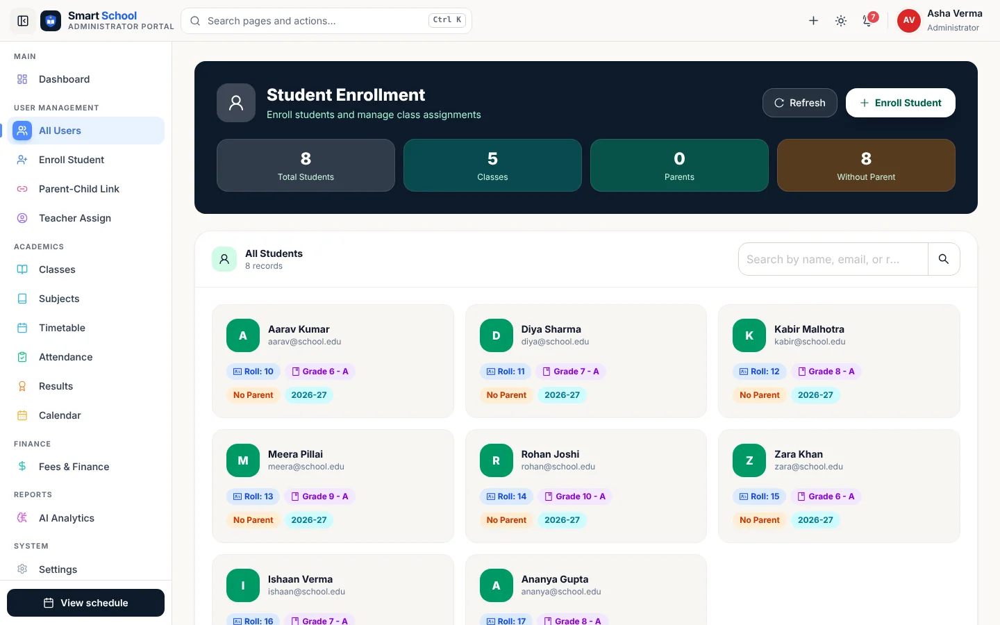<br />
      <sub><b>Student management</b>: enrollment, class placement and parent links</sub>
    </td>
    <td width="50%" align="center">
      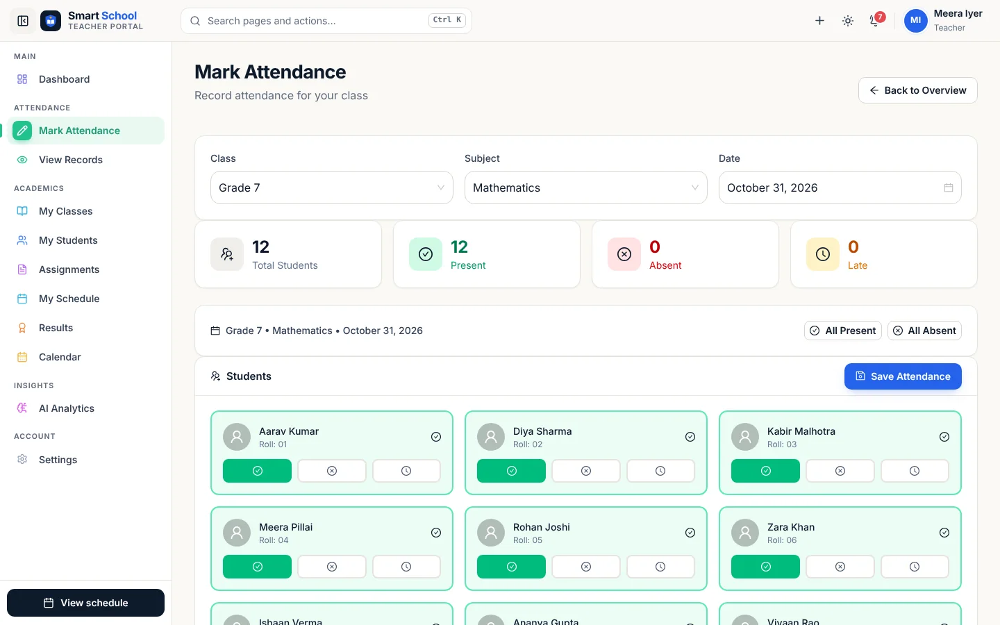<br />
      <sub><b>Attendance</b>: mark a whole class as present, absent or late</sub>
    </td>
  </tr>
  <tr>
    <td width="50%" align="center">
      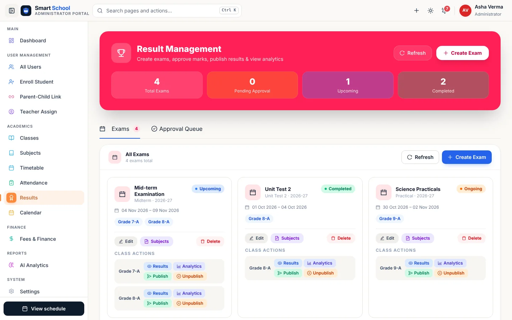<br />
      <sub><b>Results</b>: exams, marks approval and publishing</sub>
    </td>
    <td width="50%" align="center">
      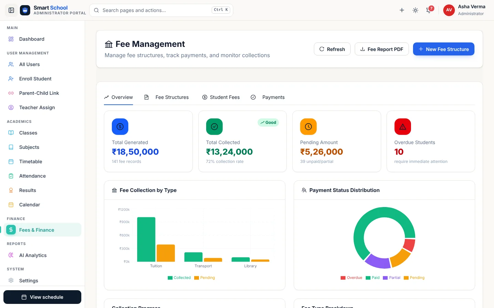<br />
      <sub><b>Fees</b>: billed vs collected, fee types and payment status</sub>
    </td>
  </tr>
</table>
</details>

<details>
<summary><b>Public pages and mobile</b>: landing, sign-in, phone layouts</summary>
<br />
<table>
  <tr>
    <td width="50%" align="center">
      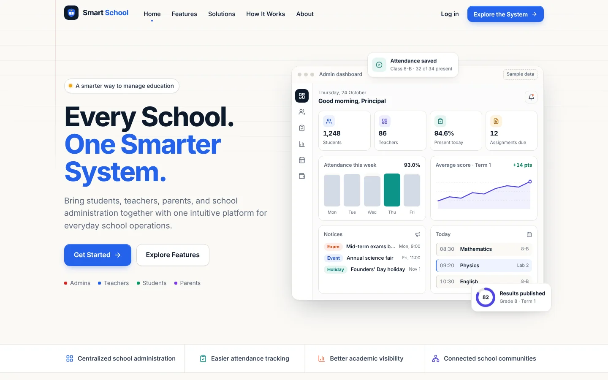<br />
      <sub><b>Landing page</b></sub>
    </td>
    <td width="50%" align="center">
      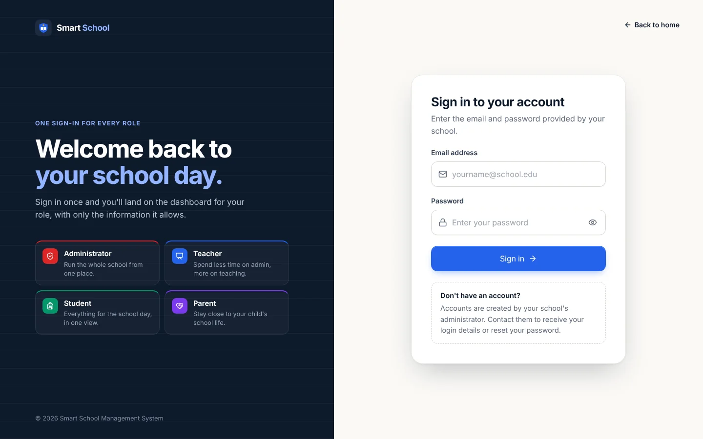<br />
      <sub><b>Sign in</b>: one sign-in for every role</sub>
    </td>
  </tr>
</table>
<p align="center">
  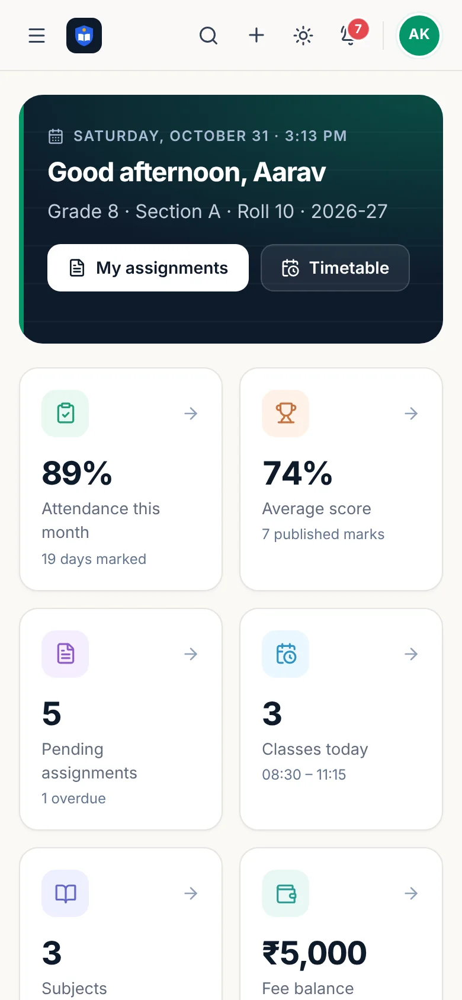
  &nbsp;&nbsp;
  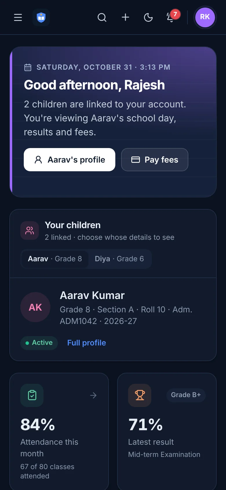
  <br />
  <sub>Phone layouts: the sidebar becomes a slide-out drawer and cards stack</sub>
</p>
</details>

<br />

## ✨ Key features

###  Administration

<table>
  <tr>
    <td width="33%" valign="top"><br /><b>User management</b><br /><sub>Teacher, student, parent and admin accounts</sub></td>
    <td width="33%" valign="top"><br /><b>Student enrollment</b><br /><sub>Enroll into a class and section</sub></td>
    <td width="33%" valign="top"><br /><b>Parent–child linking</b><br /><sub>Connect parents to their children</sub></td>
  </tr>
  <tr>
    <td valign="top"><br /><b>Classes and subjects</b><br /><sub>Classes, sections and subject codes</sub></td>
    <td valign="top"><br /><b>Teacher assignments</b><br /><sub>Class teachers and subject teachers</sub></td>
    <td valign="top"><br /><b>Timetables</b><br /><sub>Weekly schedules per class</sub></td>
  </tr>
  <tr>
    <td valign="top"><br /><b>Attendance</b><br /><sub>School-wide records and class statistics</sub></td>
    <td valign="top"><br /><b>Results and report cards</b><br /><sub>Exams, marks approval, publishing</sub></td>
    <td valign="top"><br /><b>Fee management</b><br /><sub>Structures, records, payments, PDF bills</sub></td>
  </tr>
  <tr>
    <td valign="top"><br /><b>School calendar</b><br /><sub>Exams, holidays, events, announcements</sub></td>
    <td valign="top"><br /><b>AI analytics</b><br /><sub>Class performance and students needing support</sub></td>
    <td valign="top"></td>
  </tr>
</table>

###  Teacher

<table>
  <tr>
    <td width="33%" valign="top"><br /><b>Classes and students</b><br /><sub>Assigned classes and their students</sub></td>
    <td width="33%" valign="top"><br /><b>Attendance</b><br /><sub>Mark a class and review records</sub></td>
    <td width="33%" valign="top"><br /><b>Assignments</b><br /><sub>Create, collect and grade submissions</sub></td>
  </tr>
  <tr>
    <td valign="top"><br /><b>Marks entry</b><br /><sub>Enter exam marks and submit for approval</sub></td>
    <td valign="top"><br /><b>Teaching schedule</b><br /><sub>Today's periods and the weekly timetable</sub></td>
    <td valign="top"><br /><b>AI class analytics</b><br /><sub>Insights for the classes you teach</sub></td>
  </tr>
</table>

###  Student

<table>
  <tr>
    <td width="33%" valign="top"><br /><b>Timetable</b><br /><sub>Today's classes and the week</sub></td>
    <td width="33%" valign="top"><br /><b>Assignments</b><br /><sub>Deadlines, submissions and grades</sub></td>
    <td width="33%" valign="top"><br /><b>Attendance</b><br /><sub>Monthly rate and daily history</sub></td>
  </tr>
  <tr>
    <td valign="top"><br /><b>Results</b><br /><sub>Published marks and report cards</sub></td>
    <td valign="top"><br /><b>Fee status</b><br /><sub>Balance, history and bills</sub></td>
    <td valign="top"><br /><b>Calendar and AI insights</b><br /><sub>School events and personal analytics</sub></td>
  </tr>
</table>

###  Parent

<table>
  <tr>
    <td width="33%" valign="top"><br /><b>Child information</b><br /><sub>Every linked child, one at a time</sub></td>
    <td width="33%" valign="top"><br /><b>Attendance</b><br /><sub>This month and recent school days</sub></td>
    <td width="33%" valign="top"><br /><b>Academic results</b><br /><sub>Published results and report cards</sub></td>
  </tr>
  <tr>
    <td valign="top"><br /><b>Fees</b><br /><sub>Status, payment history and bills</sub></td>
    <td valign="top"><br /><b>Timetable</b><br /><sub>Your child's weekly schedule</sub></td>
    <td valign="top"><br /><b>Calendar and AI insights</b><br /><sub>School events and child analytics</sub></td>
  </tr>
</table>

> **Planned, not yet available:** in-app messaging and a full notification centre. Their pages currently show a placeholder; see [Future improvements](#-future-improvements).

<br />

## 🔐 Role-based access

| Role | Colour | Lands on | Can access |
| --- | --- | --- | --- |
| Administrator | 🔴 Red | `/admin/dashboard` | Everything: users, academics, attendance, results, fees, calendar, analytics |
| Teacher | 🔵 Blue | `/teacher/dashboard` | Their classes, students, attendance, assignments, marks entry, schedule |
| Student | 🟢 Green | `/student/dashboard` | Their own timetable, assignments, attendance, results and fees |
| Parent | 🟣 Purple | `/parent/dashboard` | Their linked children's attendance, results, fees and timetable |

The frontend guards every route (`PrivateRoute` for signed-in users, `RoleRoute` for the allowed roles), and the backend enforces the same rules on every API call, including record-level checks such as a parent only seeing their own children.

<br />

## 🎨 UI and UX highlights

<table>
  <tr>
    <td width="50%" valign="top"><br /><b>Light, dark and system themes</b><br /><sub>Every dashboard follows the chosen theme; the choice is remembered</sub></td>
    <td width="50%" valign="top"><br /><b>Command palette</b><br /><sub>Ctrl/⌘ K or <code>/</code> jumps to any page or action for your role</sub></td>
  </tr>
  <tr>
    <td valign="top"><br /><b>Calendar alerts</b><br /><sub>The topbar bell lists upcoming exams, deadlines and announcements</sub></td>
    <td valign="top"><br /><b>Colour-coded modules</b><br /><sub>Students blue, attendance emerald, exams orange, finance teal and more</sub></td>
  </tr>
  <tr>
    <td valign="top"><br /><b>Interactive charts</b><br /><sub>Recharts visualisations of real data, with animated counters</sub></td>
    <td valign="top"><br /><b>Responsive to 320px</b><br /><sub>Collapsible sidebar on desktop, slide-out drawer on phones</sub></td>
  </tr>
  <tr>
    <td valign="top"><br /><b>Accessible</b><br /><sub>Keyboard navigation, skip links, ARIA labels, reduced-motion support</sub></td>
    <td valign="top"><br /><b>Purposeful motion</b><br /><sub>Page transitions, staggered cards and chart animations, kept subtle</sub></td>
  </tr>
</table>

**Design system:** warm off-white surfaces, navy text, blue, indigo, teal, coral and amber accents, and the Inter typeface. Tokens live in `src/styles/tokens.css` and are shared by the landing page, the sign-in page and the dashboards. Ant Design is themed from the same tokens.

<br />

## 🧰 Technology stack

<p align="center">
  
  
  
  
  
  
  
  
  
  <br />
  
  
  
  
  
  
</p>

| Layer | Technology | Used for |
| --- | --- | --- |
| UI framework | **React 19** | Components and state (React Context for auth, sidebar and theme) |
| Build tool | **Vite 7** (rolldown) | Dev server, production build, per-role code splitting |
| Routing | **React Router 7** | Public, private and role-guarded routes |
| Components | **Ant Design 6** | Tables, forms, modals, date pickers, themed light and dark |
| Styling | **Tailwind CSS 4** | Utility styling, mapped onto the design tokens |
| Charts | **Recharts 3** | Dashboard charts |
| Icons | **Lucide React** | Navigation and module icons |
| HTTP | **Axios** | API clients in `src/services/` |
| Documents | **jsPDF** + jspdf-autotable | Downloadable fee bills and fee reports |
| Dates | **Day.js** | Date formatting and calculations |
| Backend | **Node.js, Express, MongoDB** | REST API with JWT auth ([backend repository](https://github.com/AashiQMahato/Smart-School-management-system-Backend)) |

<br />

## 🏗 Architecture

### System overview

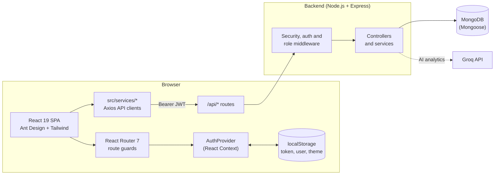

### Sign-in and authentication

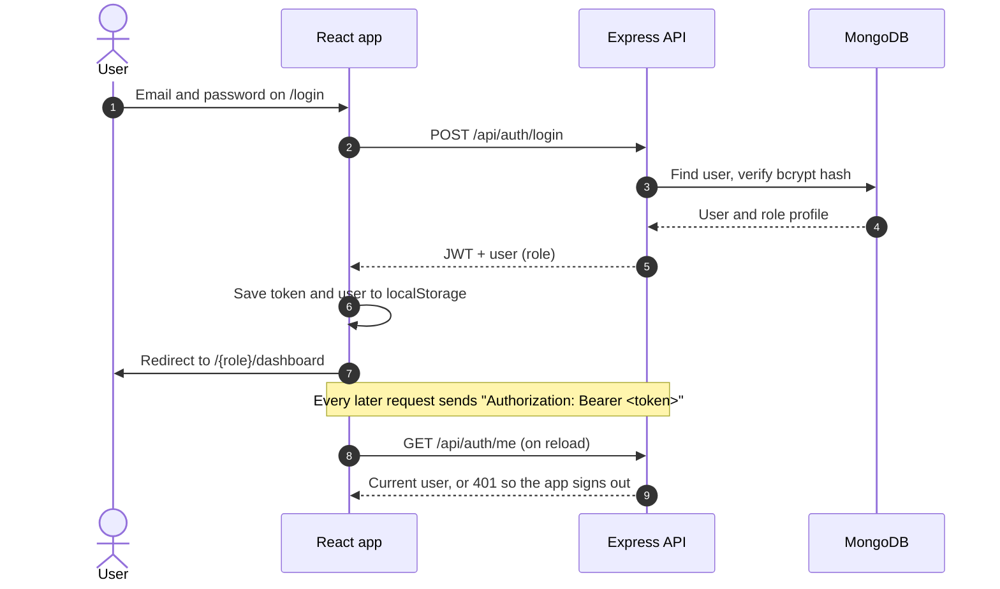

### Role-based routing

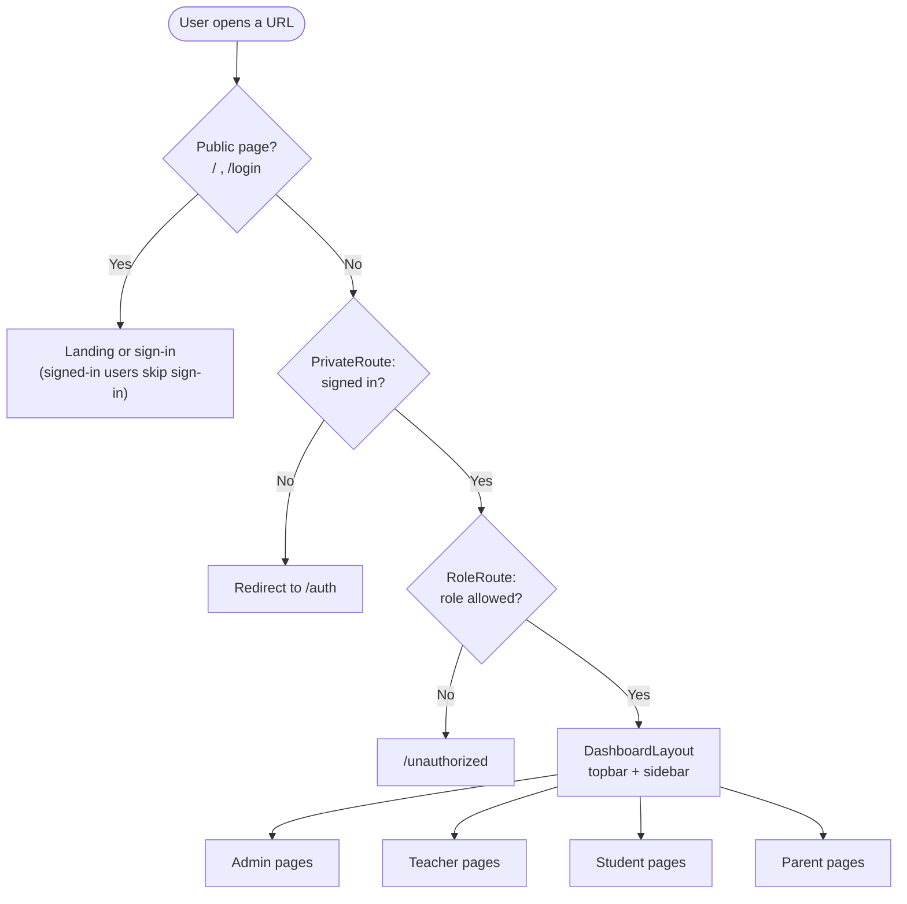

### How the roles work together

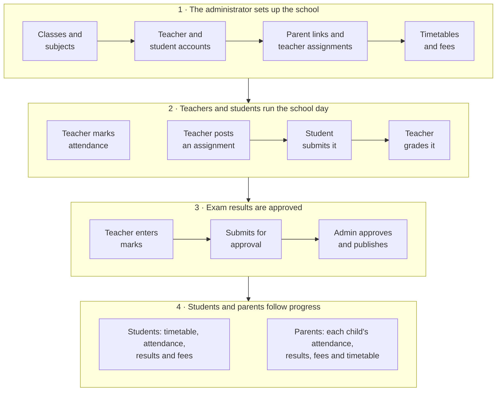

<br />

## 🚀 Getting started

### Prerequisites

- **Node.js 20.19+ or 22.12+** (required by Vite 7)
- **npm** (comes with Node.js)
- A running instance of the **[backend API](https://github.com/AashiQMahato/Smart-School-management-system-Backend)**

### Install and run

```bash
# 1. Clone the repository
git clone https://github.com/AashiQMahato/Smart-School-management-system-Frontend.git
cd Smart-School-management-system-Frontend

# 2. Install dependencies
npm install

# 3. Configure the API URL
cp .env.example .env        # then set VITE_API_BASE_URL

# 4. Start the development server
npm run dev                 # http://localhost:5173
```

### Scripts

| Command | What it does |
| --- | --- |
| `npm run dev` | Start the development server with hot reload |
| `npm run build` | Production build into `dist/` |
| `npm run preview` | Serve the production build locally |
| `npm run lint` | Run ESLint |
| `npm run gen:dark-palette` | Regenerate `src/styles/dark-palette.css` after a Tailwind upgrade |

<br />

## 🔑 Environment variables

| Variable | Required | Description |
| --- | --- | --- |
| `VITE_API_BASE_URL` | Yes, outside local development | Backend API base URL **including `/api`**, for example `https://your-backend.onrender.com/api`. Defaults to `http://localhost:8080/api`. |

The variable is read at **build time**, so rebuild after changing it. Never commit your `.env` file; the frontend holds no secrets, and the API's own secrets (database URI, JWT secret) belong to the backend's environment only.

<br />

## 📂 Project structure

```text
src/
├── app/
│   ├── layouts/        # AuthLayout, DashboardLayout + dashboard.css (shell styles)
│   ├── providers/      # AuthProvider: session, login, logout
│   ├── routes/         # PublicRoutes, PrivateRoute, RoleRoute guards
│   └── theme/          # Ant Design light and dark themes
├── components/
│   ├── Header/         # Topbar: command palette, notifications, account menu
│   ├── Sidebar/        # Sidebar + navigation config (single source per role)
│   ├── UI/             # Shared kit: StatCard, Panel, ProgressRing, charts, states
│   └── …               # Attendance, Assignment, Calendar, Results, Schedule, Analytics
├── config/             # API base URL
├── context/            # SidebarContext, ThemeContext
├── features/
│   ├── admin/          # Administrator pages
│   ├── teacher/        # Teacher pages
│   ├── student/        # Student pages
│   ├── parent/         # Parent pages
│   ├── fee/            # Fee components and PDF generation
│   └── landing/        # Public landing and sign-in components
├── hooks/              # useAuth, useCountUp, useNow, useRoleEvents
├── pages/              # Landing, sign-in, settings, 404, unauthorized
├── services/           # One API client per backend resource
├── styles/             # Design tokens and the generated dark palette
├── utils/              # Small helpers (safe text from rich content)
├── App.jsx             # Routes
└── main.jsx
```

| Folder | Role in the app |
| --- | --- |
| `src/app/` | The application shell: layouts, the auth provider, route guards and the Ant Design themes. |
| `src/components/` | Reusable building blocks. `UI/` is the shared kit every dashboard uses; `Header/` and `Sidebar/` form the dashboard shell. |
| `src/features/` | One folder per role (`admin`, `teacher`, `student`, `parent`) holding that role's pages, plus shared domains like `fee` and the public `landing`. |
| `src/services/` | API clients, one per backend resource (`attendance.service.js`, `fee.service.js` …). Pages never call the API directly. |
| `src/styles/` | Design tokens (`tokens.css`) and the generated dark-mode palette. |
| `src/hooks/` | Shared hooks: auth, live clock, number count-up, role calendar events. |
| `src/pages/` | Pages outside the role dashboards: landing, sign-in, user settings and error pages. |

Role pages are **lazy-loaded per route**, so each user only downloads the code for their own dashboard.

<br />

## 🌐 Deployment

The app is a static single-page application:

1. Set `VITE_API_BASE_URL` to your backend's URL (including `/api`).
2. Run `npm run build`.
3. Serve the `dist/` folder as a static site, with **every path rewritten to `index.html`** because the app uses client-side routing.

The live app runs on [Render](https://render.com) as a static site, alongside the backend as a Render web service.

> **CORS:** the backend only accepts requests from origins in its allowlist. When you deploy the frontend to a new URL, add that URL to the backend's `CORS_ORIGINS` environment variable, or the browser will block API calls.

<br />

## 🔭 Future improvements

These are planned; their routes exist today but show a placeholder page:

- [ ] In-app messaging between teachers and parents
- [ ] A full notification centre (the topbar already shows calendar alerts)
- [ ] An admin reports and analytics page
- [ ] A detailed student view for teachers
- [ ] A dedicated grades page for students and performance reports for parents

<br />

## 🤝 Contributing

1. Fork the repository and create a branch: `git checkout -b feature-name`
2. Make your change, then run `npm run lint` and `npm run build`
3. Open a pull request describing what changed and why

<br />

## 📄 License

This project is licensed under the MIT License.

<br />

## 👨‍💻 Developer

<table>
  <tr>
    <td></td>
    <td>
      <b>Smart School Management System</b><br />
      Built and maintained by <a href="https://github.com/AashiQMahato">AashiQMahato</a><br />
      <sub>Frontend: this repository · Backend: <a href="https://github.com/AashiQMahato/Smart-School-management-system-Backend">Smart-School-management-system-Backend</a></sub>
    </td>
  </tr>
</table>

<div align="center">
<br />
<sub>Every School. One Smarter System.</sub>
</div>
